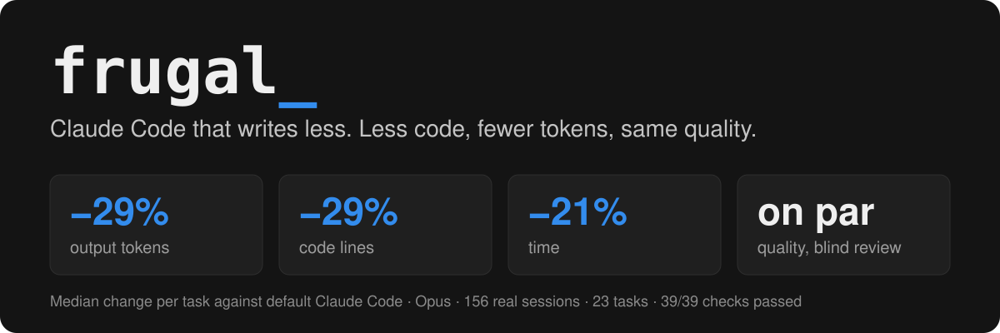

<p align="center">
  
</p>

<p align="center">
  
  
</p>

# frugal

**Claude Code over-builds. frugal stops it.**

Ask for an email validator and you get 59 lines, a test harness and an essay. With frugal you get the 4 lines you needed and a short note on what it doesn't cover. Same model, same passing tests, 40% fewer output tokens.

It is one short rules file, about 250 tokens, delivered by a hook to every session and subagent. No config, no levels, no per-prompt reminder. `/frugal off` turns it off.

## Install

```bash
claude plugin marketplace add MateiSR/frugal
claude plugin install frugal@frugal
```

Restart Claude Code (2.1.296 or newer). That's it: frugal is on in every session. `/frugal` shows what it has measured, `/frugal off` and `/frugal on` switch it.

## Before and after

One prompt, one real Opus session each: *"Write me a Python function that validates email addresses."*

<table>
<tr>
<th width="50%">Default Claude Code · 59 lines · 1,259 output tokens · 10.7 s</th>
<th width="50%">frugal · 4 lines · 245 output tokens · 2.8 s</th>
</tr>
<tr>
<td valign="top">

<details>
<summary>Two regexes, a 40-line function, a docstring listing its own checks and a 16-case test harness (click to expand)</summary>

```python
import re

# Local part: letters, digits, and common special characters. No leading,
# trailing, or consecutive dots.
_LOCAL_RE = re.compile(
    r"^[A-Za-z0-9!#$%&'*+/=?^_`{|}~-]+(\.[A-Za-z0-9!#$%&'*+/=?^_`{|}~-]+)*$"
)

# Domain label: 1-63 chars, alphanumeric at both ends, hyphens allowed inside.
_LABEL_RE = re.compile(r"^[A-Za-z0-9]([A-Za-z0-9-]{0,61}[A-Za-z0-9])?$")


def is_valid_email(email: str) -> bool:
    """Return True if `email` is a syntactically valid email address.

    Checks:
      - exactly one '@'
      - local part <= 64 chars, allowed characters, no bad dot placement
      - domain <= 253 chars, at least two labels, each label valid
      - top-level domain is alphabetic and at least 2 chars
      - total length <= 254 chars
    """
    if not isinstance(email, str) or len(email) > 254:
        return False

    if email.count("@") != 1:
        return False

    local, domain = email.split("@")

    # Local part
    if not local or len(local) > 64 or not _LOCAL_RE.match(local):
        return False

    # Domain (accept internationalized domains by converting to punycode)
    try:
        domain = domain.encode("idna").decode("ascii")
    except UnicodeError:
        return False

    if not domain or len(domain) > 253:
        return False

    labels = domain.split(".")
    if len(labels) < 2:
        return False

    if not all(_LABEL_RE.match(label) for label in labels):
        return False

    tld = labels[-1]
    if len(tld) < 2 or not (tld.isalpha() or tld.lower().startswith("xn--")):
        return False

    return True


if __name__ == "__main__":
    tests = {
        "user@example.com": True,
        "first.last+tag@sub.example.co.uk": True,
        "o'reilly@example.org": True,
        "user@münchen.de": True,
        "plainaddress": False,
        "@example.com": False,
        "user@": False,
        "user@@example.com": False,
        ".user@example.com": False,
        "user.@example.com": False,
        "us..er@example.com": False,
        "user@localhost": False,
        "user@-example.com": False,
        "user@example.c": False,
        "user@example..com": False,
        "a" * 65 + "@example.com": False,
    }
    for addr, expected in tests.items():
        result = is_valid_email(addr)
        status = "OK  " if result == expected else "FAIL"
        print(f"{status} {addr!r:45} -> {result}")
```

</details>

Plus three paragraphs on what it doesn't accept.

</td>
<td valign="top">

```python
import re

_EMAIL_RE = re.compile(r"^[A-Za-z0-9._%+-]+@[A-Za-z0-9-]+(\.[A-Za-z0-9-]+)*\.[A-Za-z]{2,}$")

def is_valid_email(email: str) -> bool:
    return bool(_EMAIL_RE.fullmatch(email))
```

Plus one paragraph: it checks format only, rejects some unusual addresses the RFC allows, and names the `email-validator` package if you need more.

</td>
</tr>
</table>

The default version is more thorough. frugal's bet is that you asked for a function, not a library, and that it should tell you what it left out so you can ask for it.

## Benchmark

156 real headless Claude Code sessions on Opus: frugal 0.6 against default Claude Code and the two plugins it borrows from, [Honey](https://github.com/Green-PT/honey-for-devs) and [Ponytail](https://github.com/DietrichGebert/ponytail).

<p align="center">
  <picture>
    <source media="(prefers-color-scheme: dark)" srcset="assets/benchmark-dark.svg">
    
  </picture>
</p>

Median change per task against default Claude Code; code lines are the total over all 23 tasks.

| | Output tokens | Session cost | Time | Code lines written | Checks passed |
| :--- | ---: | ---: | ---: | ---: | ---: |
| Default Claude Code | baseline | baseline | baseline | 409 | 39/39 |
| **frugal 0.6** | **−40%** | **−6%** | **−30%** | **160** | 39/39 |
| Honey 1.4.0 | −32% | −9% | −26% | 189 | 39/39 |
| Ponytail 5.3.3 | +3% (ns) | +23% | −3% (ns) | 290 | 39/39 |

`(ns)` means not statistically significant (p ≥ 0.05, exact Wilcoxon signed-rank test over the 23 tasks). Every other change in the table is significant.

What the numbers say:

- frugal writes the least output and the least code and is the fastest. Honey is slightly cheaper per session (−9% against −6%), because it injects fewer tokens.
- Cost moves far less than output, because output is a small share of what a session bills; most of it is input and cache. That is also why Ponytail costs more than the default here: its rules and repo map add about 30% to the uncached input, which its shorter output does not pay back on small tasks.
- The gap is widest on open-ended requests. On the eight tasks where code size varies most, frugal cut cost by 28% and code lines by 64% (Honey −26% and −46%, Ponytail −3% and −38%, neither Ponytail figure significant). On Ponytail's own five prompts ("write me an email validator", "build me a countdown timer in React"), default Claude Code wrote 225 lines, Ponytail 71, Honey 60, frugal 45.
- Every arm passed every check, so these tasks do not show a quality difference in either direction. Nothing here measures whether the shorter code is better; a 4-line email validator is shorter, not necessarily what you wanted.

<details>
<summary><b>How it was run</b></summary>

- Each session is a real headless Claude Code run (`claude -p`, `--model opus`, Claude Code 2.1.332) in a fresh workspace, with file tools only and no user settings, rules, output style or MCP servers (`--setting-sources project --strict-mcp-config`).
- Each arm loads exactly one plugin with `--plugin-dir`, at its default full level: Ponytail at commit `ebd8654`, Honey at `cc82b7e`, frugal with the rules shipped in 0.6. Before the run, a probe session per plugin confirms its instructions reached the model.
- 23 tasks: 13 of our own (9 unit-tested code tasks and bug fixes, 3 explanations, a review), Ponytail's five open-ended prompts copied verbatim from its benchmark config, and five of Honey's unit-tested tasks read from its repository.
- The eight tasks where code size varies most ran 3 times per arm and the other 15 once, to limit the number of sessions. Runs of a task are collapsed by median before comparing.
- Checks are unit tests for code tasks, required facts for explanations and "produced code" for the open-ended prompts. One of the unit-tested tasks is a path-traversal guard that is implied but not asked for.
- Code lines are the non-blank, non-comment lines in every file the session wrote or changed, or the code blocks in its reply if it wrote no file. Cost is Claude Code's own `total_cost_usd`, so it includes the tokens each plugin injects.
- Not measured: long multi-turn sessions, tasks that run shell commands, models other than Opus, and Caveman (its rules cover prose only, not how much code to write).
- Full report with per-task numbers and every reply: [`bench/results/2026-11-19-opus-v0.6`](bench/results/2026-11-19-opus-v0.6/report.md). To re-run it, clone the two plugins into a sibling `token-savers/` directory and run:

```bash
node bench/run.js --stamp <name> --model opus --runs 1 --arms off,on,ponytail,honey --dry   # prints the session count; drop --dry and add --yes to start
```

</details>

Earlier runs, including the Sonnet runs behind frugal 0.4 and the rules variants that were tried and dropped, are in [`bench/results/`](bench/results) and [`bench/variants/`](bench/variants).

## Frugal mode

### The rules

One short file, [`rules/frugal.md`](rules/frugal.md):

- **Least code** — use the repo's helpers, the standard library or an installed dependency before writing new code.
- **Smallest version** — a vague request gets the version that does the core job. No options, wrappers, extra files, demo code, signature-restating docstrings or "for later" code nobody asked for; comments only for a why the code cannot show.
- **Fix the cause** — check the other callers of what you change.
- **Keep what makes code safe** — validation at trust boundaries, error handling that prevents data loss, security, accessibility, anything the user asked for.
- **Brief replies** — answer first, no preamble or narration, no repeating code already written to a file, one line on anything left out or not checked, a fuller explanation when asked or when brevity would hide a risk. Code, identifiers, commands and errors stay exact.
- **Read less** — search before reading, never re-read unchanged files.

### When they are injected

| Moment | Hook | What is sent |
| :--- | :--- | :--- |
| Session start, resume, `/clear`, after compaction | `SessionStart` | The rules (about 250 tokens) |
| A subagent starts | `SubagentStart` | The rules, except to agents that only locate, plan or look |
| The mode was switched mid-session | `UserPromptSubmit` | The rules once (on), or a one-line "disregard them" (off) |

Nothing is added on ordinary prompts, and nothing at all when the mode is off. This is done with hooks rather than a skill or your `CLAUDE.md`, so it reaches subagents and is removed when you uninstall.

### `/frugal`

```text
/frugal                    show whether the mode is on here, and why
/frugal off                off for this session
/frugal on                 on for this session
/frugal off project        off for this project, until changed
/frugal on project
/frugal off global         off on this machine, until changed
/frugal on global
/frugal stats              token usage for this session
/frugal stats all          token usage for every session frugal has seen
```

The most specific setting wins: session, then project, then global. With nothing set, the mode is on. The reply comes from a hook, so it spends no model tokens.

### Stats

```text
Frugal stats · this session
  main          41 msgs · out 52.0k · in 88 · cache write 128.8k · cache read 4.36M
  subagents     22 msgs · out 31.2k · in 44 · cache write 302.0k · cache read 1.20M
  frugal added ≈530 input tokens (rules ×1, subagent rules ×1, off notices ×0; estimated at 4 chars per token, before caching)
  savings: not enough data to compare (need 20+ messages each with frugal on and off; have 41 on, 0 off)
```

- Token counts are read from Claude Code's own session transcripts, so they are measured.
- "frugal added" is the plugin's own overhead, estimated from the size of the text it injected.
- Savings are shown only as an observed comparison of output tokens per message with the mode on and off, once there are at least 20 messages of each. There is no assumed percentage. The sessions being compared ran different tasks, so read it as an indication; the benchmark above is the controlled number.
- Nothing about stats is added to the model's context. The hook writes one short line per event to `~/.claude/frugal/log.jsonl` and computes the rest when you ask.

State and the log live in `~/.claude/frugal/` and are left in place if you uninstall.

## Orchestration

```text
/frugal:orchestrate <task> [models=all|opus,sonnet,haiku,fable] [top=few|none|free] [stops=plan|each|end] [commits=package|none]
```

Defaults: `models=all`, `top=few`, `stops=plan`, `commits=package`. Commits are local only; it never pushes. This part is not benchmarked.

0. **Bootstrap** — adds `.claude/worktrees/` and `.orchestrate/` to the clone's local `.git/info/exclude`. If the repo's `CLAUDE.md` has no Execution Constraints section, a researcher drafts one into `.orchestrate/CONSTRAINTS.md` for you to correct.
1. **Research** — parallel read-only `researcher` agents over disjoint slices.
2. **Plan** — written to `.orchestrate/PLAN.md` with streams, packages and Done Contracts; stops for approval by default.
3. **Warm streams** — each `stream-worker` takes a sequence of packages and is resumed with `SendMessage`, keeping its 1-hour prompt cache. Parallel worktrees only for substantial, disjoint work.
4. **Merge** — worktree branches merged one at a time.
5. **Acceptance** — a fresh `reviewer` runs the real end-to-end checks.

| Agent | Model / effort | Why it is a subagent |
| :--- | :--- | :--- |
| `frugal:stream-worker` | `opus` / `high`, 1h cache | Parallel work in its own worktree, isolated from the planner |
| `frugal:researcher` | `sonnet` / `medium` | Cheaper model, read-only tools, absorbs bulk reading |
| `frugal:visual-verifier` | `opus` / `medium` | Keeps image tokens out of the worker's context |
| `frugal:reviewer` | `fable` / `medium` | Independent of the code's author; blockers at confidence `>= 75` only |

`/frugal:debug` is a skill, not an agent: a root-cause method the worker follows when a bug survives two fixes. You can also invoke it yourself.

Optional: merge `templates/settings-snippet.json` into `~/.claude/settings.json` so worktrees branch from your local HEAD, and use `templates/project-CLAUDE-snippet.md` to write a repo's Execution Constraints by hand. Leave `subagentPromptCacheTtl` and `CLAUDE_CODE_EXPERIMENTAL_AGENT_TEAMS` unset.

## Develop

```bash
claude plugin validate .
claude --plugin-dir .
node bench/run.js --selftest
```

See [`docs/`](docs/) for how the mode, the orchestration, the benchmark and the release process work.

## Update

```bash
claude plugin update frugal@frugal
```

Then `/reload-plugins` in any open session.

## License

MIT. The rules are adapted from the `honey` skill of [Honey for Devs](https://github.com/Green-PT/honey-for-devs) (MIT), with several sentences from [Ponytail](https://github.com/DietrichGebert/ponytail) (MIT); see `NOTICE`. The hook design follows the approach used by Honey, Caveman and Ponytail, and the benchmark method borrows from Honey's and Ponytail's.
