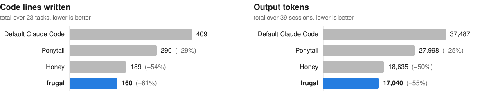

<p align="center">
  
</p>

<p align="center">
  
  
</p>

# frugal

**Claude Code over-builds. frugal stops it.**

Ask for an email validator and you get 59 lines, a test harness and an essay. With frugal you get the 8 lines you needed and three lines on what they don't cover. Same model, same passing tests, about 30% less output, and a blind review rates the result as good as the default.

It is one short rules file, about 330 tokens, delivered by a hook to every session and subagent. No config, no levels, no per-prompt reminder. `/frugal off` turns it off.

## Install

```bash
claude plugin marketplace add MateiSR/frugal
claude plugin install frugal@frugal
```

Restart Claude Code (2.1.296 or newer). That's it: frugal is on in every session. `/frugal` shows what it has measured, `/frugal off` and `/frugal on` switch it.

## Other tools

The benchmark numbers below were measured in Claude Code on Opus only. Other tools receive the same rules file (`rules/frugal.md`) and are supported, but not benchmarked.

| Tool | Delivery | Toggleable |
| :--- | :--- | :--- |
| Claude Code | Hooks (plugin) | Yes (`/frugal on\|off`) |
| Gemini CLI | Static file (`gemini-extension.json` → `AGENTS.md`) | No (disable extension) |
| Codex, OpenCode, Amp, Jules, Zed, Aider, Goose, Grok, etc. | Static file (`AGENTS.md`) | No |

Install in Gemini CLI:

```bash
gemini extensions install https://github.com/MateiSR/frugal
```

Or copy `AGENTS.md` into your project root for any tool that reads it.

## Before and after

One prompt, one real Opus session each: *"Write me a Python function that validates email addresses."*

**With frugal** — 8 lines · 708 output tokens · 6.7 s

```python
import re

_EMAIL = re.compile(
    r"(?P<local>[A-Za-z0-9!#$%&'*+/=?^_`{|}~-]+(?:\.[A-Za-z0-9!#$%&'*+/=?^_`{|}~-]+)*)"
    r"@(?:[A-Za-z0-9](?:[A-Za-z0-9-]{0,61}[A-Za-z0-9])?\.)+[A-Za-z]{2,63}"
)

def is_valid_email(address: str) -> bool:
    m = _EMAIL.fullmatch(address)
    return bool(m) and len(address) <= 254 and len(m["local"]) <= 64
```

Plus three lines: which rules it checks, which rare valid forms it rejects, and that only a confirmation email proves an address exists.

**Default Claude Code** — 59 lines · 1,259 output tokens · 10.7 s

<details>
<summary>Show all 59 lines: two regexes, a 40-line function, a docstring listing its own checks and a 16-case test harness</summary>

```python
import re

# Local part: letters, digits, and common special characters. No leading,
# trailing, or consecutive dots.
_LOCAL_RE = re.compile(
    r"^[A-Za-z0-9!#$%&'*+/=?^_`{|}~-]+(\.[A-Za-z0-9!#$%&'*+/=?^_`{|}~-]+)*$"
)

# Domain label: 1-63 chars, alphanumeric at both ends, hyphens allowed inside.
_LABEL_RE = re.compile(r"^[A-Za-z0-9]([A-Za-z0-9-]{0,61}[A-Za-z0-9])?$")


def is_valid_email(email: str) -> bool:
    """Return True if `email` is a syntactically valid email address.

    Checks:
      - exactly one '@'
      - local part <= 64 chars, allowed characters, no bad dot placement
      - domain <= 253 chars, at least two labels, each label valid
      - top-level domain is alphabetic and at least 2 chars
      - total length <= 254 chars
    """
    if not isinstance(email, str) or len(email) > 254:
        return False

    if email.count("@") != 1:
        return False

    local, domain = email.split("@")

    # Local part
    if not local or len(local) > 64 or not _LOCAL_RE.match(local):
        return False

    # Domain (accept internationalized domains by converting to punycode)
    try:
        domain = domain.encode("idna").decode("ascii")
    except UnicodeError:
        return False

    if not domain or len(domain) > 253:
        return False

    labels = domain.split(".")
    if len(labels) < 2:
        return False

    if not all(_LABEL_RE.match(label) for label in labels):
        return False

    tld = labels[-1]
    if len(tld) < 2 or not (tld.isalpha() or tld.lower().startswith("xn--")):
        return False

    return True


if __name__ == "__main__":
    tests = {
        "user@example.com": True,
        "first.last+tag@sub.example.co.uk": True,
        "o'reilly@example.org": True,
        "user@münchen.de": True,
        "plainaddress": False,
        "@example.com": False,
        "user@": False,
        "user@@example.com": False,
        ".user@example.com": False,
        "user.@example.com": False,
        "us..er@example.com": False,
        "user@localhost": False,
        "user@-example.com": False,
        "user@example.c": False,
        "user@example..com": False,
        "a" * 65 + "@example.com": False,
    }
    for addr, expected in tests.items():
        result = is_valid_email(addr)
        status = "OK  " if result == expected else "FAIL"
        print(f"{status} {addr!r:45} -> {result}")
```

</details>

Plus three paragraphs on what it doesn't accept.

Both enforce the same length and character rules. frugal leaves out the test harness, the docstring that repeats the code and the internationalized-domain handling, and says so.

## Benchmark

156 real headless Claude Code sessions on Opus: frugal 0.7 against default Claude Code and the two plugins it borrows from, [Honey](https://github.com/Green-PT/honey-for-devs) and [Ponytail](https://github.com/DietrichGebert/ponytail). Then a blind review of what each one produced.

<p align="center">
  <picture>
    <source media="(prefers-color-scheme: dark)" srcset="assets/benchmark-dark.svg">
    
  </picture>
</p>

### Savings

Median change per task against default Claude Code; code lines are the total over all 23 tasks.

| | Output tokens | Session cost | Time | Code lines written | Checks passed |
| :--- | ---: | ---: | ---: | ---: | ---: |
| Default Claude Code | baseline | baseline | baseline | 407 | 39/39 |
| **frugal 0.7** | **−29%** | **0% (ns)** | **−21%** | **183** | 39/39 |
| Honey 1.4.0 | −32% | −9% | −26% | 184 | 39/39 |
| Ponytail 5.3.3 | +3% (ns) | +23% | −3% (ns) | 287 | 39/39 |

`(ns)` means not statistically significant (p ≥ 0.05, exact Wilcoxon signed-rank test over the 23 tasks).

### Quality

The same outputs, shown to a judge with the names removed and the order shuffled. It scored each from 1 to 10 and ranked the four. 23 tasks, two passes each.

| | Correctness | Fit to the request | Reply | Mean rank (1 is best) | Ranked best | Ranked last |
| :--- | ---: | ---: | ---: | ---: | ---: | ---: |
| Default Claude Code | 8.6 | 8.3 | 8.2 | 2.09 | 16 | 6 |
| **frugal 0.7** | **8.9** | **8.7** | **8.3** | **2.04** | **21** | 6 |
| Ponytail 5.3.3 | 8.5 | 8.2 | 8.2 | 2.61 | 9 | 13 |
| Honey 1.4.0 | 8.3 | 8.5 | 7.7 | 3.26 | 0 | 21 |

Task by task, frugal was ranked above Honey on 18 of 23 (p = 0.004), above Ponytail on 14 of 23 (not significant) and above default Claude Code on 11, below on 9, level on 3 (not significant).

What the numbers say:

- frugal and Honey cut the same amount of code, less than half of what default Claude Code writes. Honey is a little ahead on output tokens and cost; frugal is well ahead on quality.
- frugal's quality is level with default Claude Code. That is the point: a third less output, with nothing a reviewer misses.
- Session cost does not move. Output is a small share of what a session bills; most of it is input and cache, and frugal's rules add about 9% to the uncached input. On open-ended requests, where default Claude Code over-builds most, the saving is real: on the eight tasks where code size varies most, frugal cut cost by 19%, output by 46% and code lines by 57% (Honey −25%, −50%, −43%; Ponytail's changes there are not significant).
- Savings and quality trade off. An earlier, shorter version of the rules (0.6) saved more (−40% output, −6% cost) and was ranked last in the same review, for thin replies and looser code. The rules now ask for the edge cases a careful reviewer expects and for up to three lines on what was assumed or left out.
- Ponytail costs more than the default here because its rules and repo map add about 31% to the uncached input, which its shorter output does not pay back on small tasks.

<details>
<summary><b>How it was run</b></summary>

- Each session is a real headless Claude Code run (`claude -p`, `--model opus`, Claude Code 2.1.332) in a fresh workspace, with file tools only and no user settings, rules, output style or MCP servers (`--setting-sources project --strict-mcp-config`).
- Each arm loads exactly one plugin with `--plugin-dir`, at its default full level: Ponytail at commit `ebd8654`, Honey at `cc82b7e`, frugal with the rules shipped in 0.7. Before the run, a probe session per plugin confirms its instructions reached the model.
- 23 tasks: 13 of our own (9 unit-tested code tasks and bug fixes, 3 explanations, a review), Ponytail's five open-ended prompts copied verbatim from its benchmark config, and five of Honey's unit-tested tasks read from its repository.
- The eight tasks where code size varies most ran 3 times per arm and the other 15 once, to limit the number of sessions. Runs of a task are collapsed by median before comparing.
- Checks are unit tests for code tasks, required facts for explanations and "produced code" for the open-ended prompts. One of the unit-tested tasks is a path-traversal guard that is implied but not asked for.
- Code lines are the non-blank, non-comment lines in every file the session wrote or changed, or the code blocks in its reply if it wrote no file. Cost is Claude Code's own `total_cost_usd`, so it includes the tokens each plugin injects.
- The quality judge is one Opus call per task per pass, with no tools. It sees the request, any starter files, and each arm's first-run reply and written files under a shuffled letter, scores correctness, fit and reply, then ranks. The judge is the same model family that wrote the outputs, and it is one judge, not a panel; treat small gaps as noise.
- Not measured: long multi-turn sessions, tasks that run shell commands, models other than Opus, and Caveman (its rules cover prose only, not how much code to write).
- Full report with per-task numbers and every reply: [`bench/results/2026-11-19-opus-v0.7`](bench/results/2026-11-19-opus-v0.7/report.md), judge verdicts with reasons in [`judge.jsonl`](bench/results/2026-11-19-opus-v0.7/judge.jsonl). To re-run it, clone the two plugins into a sibling `token-savers/` directory and run:

```bash
node bench/run.js --stamp <name> --model opus --runs 1 --arms off,on,ponytail,honey --dry   # prints the session count; drop --dry and add --yes to start
```

</details>

Earlier runs, including the 0.6 rules and their review, the Sonnet runs behind frugal 0.4 and the rules variants that were tried and dropped, are in [`bench/results/`](bench/results) and [`bench/variants/`](bench/variants).

## Frugal mode

### The rules

One short file, [`rules/frugal.md`](rules/frugal.md):

- **Least code** — use the repo's helpers, the standard library or an installed dependency before writing new code.
- **Smallest version, done well** — a vague request gets the version that does the core job. No options, wrappers, extra files, demo code, signature-restating docstrings or "for later" code nobody asked for.
- **Small is not sloppy** — handle the inputs and edge cases a careful reviewer would expect; between two options of similar size, take the more correct one.
- **Fix the cause** — check the other callers of what you change; inputs that worked before must still work.
- **Keep what makes code safe** — validation at trust boundaries, error handling that prevents data loss, security, accessibility, anything the user asked for.
- **Brief replies that still inform** — answer first, no preamble or narration, no repeating code already written to a file; then at most three short lines on edge behaviour, assumptions and what was left out or not checked.
- **Read less** — search before reading, never re-read unchanged files.

### When they are injected

| Moment | Hook | What is sent |
| :--- | :--- | :--- |
| Session start, resume, `/clear`, after compaction | `SessionStart` | The rules (about 330 tokens) |
| A subagent starts | `SubagentStart` | The rules, except to agents that only locate, plan or look |
| The mode was switched mid-session | `UserPromptSubmit` | The rules once (on), or a one-line "disregard them" (off) |

Nothing is added on ordinary prompts, and nothing at all when the mode is off. This is done with hooks rather than a skill or your `CLAUDE.md`, so it reaches subagents and is removed when you uninstall.

### `/frugal`

```text
/frugal                    show whether the mode is on here, and why
/frugal off                off for this session
/frugal on                 on for this session
/frugal off project        off for this project, until changed
/frugal on project
/frugal off global         off on this machine, until changed
/frugal on global
/frugal stats              token usage for this session
/frugal stats all          token usage for every session frugal has seen
```

The most specific setting wins: session, then project, then global. With nothing set, the mode is on. The reply comes from a hook, so it spends no model tokens.

### Stats

```text
Frugal stats · this session
  main          41 msgs · out 52.0k · in 88 · cache write 128.8k · cache read 4.36M
  subagents     22 msgs · out 31.2k · in 44 · cache write 302.0k · cache read 1.20M
  frugal added ≈530 input tokens (rules ×1, subagent rules ×1, off notices ×0; estimated at 4 chars per token, before caching)
  savings: not enough data to compare (need 20+ messages each with frugal on and off; have 41 on, 0 off)
```

- Token counts are read from Claude Code's own session transcripts, so they are measured.
- "frugal added" is the plugin's own overhead, estimated from the size of the text it injected.
- Savings are shown only as an observed comparison of output tokens per message with the mode on and off, once there are at least 20 messages of each. There is no assumed percentage. The sessions being compared ran different tasks, so read it as an indication; the benchmark above is the controlled number.
- Nothing about stats is added to the model's context. The hook writes one short line per event to `~/.claude/frugal/log.jsonl` and computes the rest when you ask.

State and the log live in `~/.claude/frugal/` and are left in place if you uninstall.

## Orchestration

```text
/frugal:orchestrate <task> [models=all|opus,sonnet,haiku,fable] [top=few|none|free] [stops=plan|each|end] [commits=package|none]
```

Defaults: `models=all`, `top=few`, `stops=plan`, `commits=package`. Commits are local only; it never pushes. This part is not benchmarked.

0. **Bootstrap** — adds `.claude/worktrees/` and `.orchestrate/` to the clone's local `.git/info/exclude`. If the repo's `CLAUDE.md` has no Execution Constraints section, a researcher drafts one into `.orchestrate/CONSTRAINTS.md` for you to correct.
1. **Research** — parallel read-only `researcher` agents over disjoint slices.
2. **Plan** — written to `.orchestrate/PLAN.md` with streams, packages and Done Contracts; stops for approval by default.
3. **Warm streams** — each `stream-worker` takes a sequence of packages and is resumed with `SendMessage`, keeping its 1-hour prompt cache. Parallel worktrees only for substantial, disjoint work.
4. **Merge** — worktree branches merged one at a time.
5. **Acceptance** — a fresh `reviewer` runs the real end-to-end checks.

| Agent | Model / effort | Why it is a subagent |
| :--- | :--- | :--- |
| `frugal:stream-worker` | `opus` / `high`, 1h cache | Parallel work in its own worktree, isolated from the planner |
| `frugal:researcher` | `sonnet` / `medium` | Cheaper model, read-only tools, absorbs bulk reading |
| `frugal:visual-verifier` | `opus` / `medium` | Keeps image tokens out of the worker's context |
| `frugal:reviewer` | `fable` / `medium` | Independent of the code's author; blockers at confidence `>= 75` only |

`/frugal:debug` is a skill, not an agent: a root-cause method the worker follows when a bug survives two fixes. You can also invoke it yourself.

Optional: merge `templates/settings-snippet.json` into `~/.claude/settings.json` so worktrees branch from your local HEAD, and use `templates/project-CLAUDE-snippet.md` to write a repo's Execution Constraints by hand. Leave `subagentPromptCacheTtl` and `CLAUDE_CODE_EXPERIMENTAL_AGENT_TEAMS` unset.

## Develop

```bash
claude plugin validate .
claude --plugin-dir .
node bench/run.js --selftest
```

See [`docs/`](docs/) for how the mode, the orchestration, the benchmark and the release process work.

## Update

```bash
claude plugin update frugal@frugal
```

Then `/reload-plugins` in any open session.

## License

MIT. The rules are adapted from the `honey` skill of [Honey for Devs](https://github.com/Green-PT/honey-for-devs) (MIT), with several sentences from [Ponytail](https://github.com/DietrichGebert/ponytail) (MIT); see `NOTICE`. The hook design follows the approach used by Honey, Caveman and Ponytail, and the benchmark method borrows from Honey's and Ponytail's.
